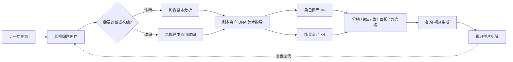

# AI Drama Skill · AI 影视短剧创作技能集

    

> **一句话**：从一句创意，到能直接投喂 AI 生成的剧本、资产与分镜——19 个覆盖影视前期全流程的中文工作流技能。

一套面向 **AI 影视与短剧创作**的开箱即用技能库（skill collection）。每个 Markdown 文件即一个独立技能，内置角色设定、执行流程、输出规范、质检清单与安全边界；既可单独调用，也可以串成 **创意 → 剧本 → 资产 → 分镜 → 复盘** 的完整生产链。

> ⚠️ 本仓库提供的是**提示词与工作规范**，不是独立软件或模型。文本、图像、视频与全景图的实际生成，需在支持相应能力的 AI 客户端（如 Claude、WorkBuddy 等支持自定义 skill 的工具）中执行。

---

## 目录

- [解决什么问题](#解决什么问题)
- [技能总览](#技能总览)
- [推荐工作流](#推荐工作流)
- [快速开始](#快速开始)
- [输入准备建议](#输入准备建议)
- [项目结构](#项目结构)
- [使用边界与安全](#使用边界与安全)
- [贡献指南](#贡献指南)

## 解决什么问题

AI 生成影视内容的最大痛点不是"单次质量"，而是**跨镜头、跨分段、跨集的一致性**：同一个角色换个镜头就变脸，同一个房间换个机位就变形。本技能集用三个机制对抗漂移：

1. **资产 DNA 先行**——在生成分镜之前，先锁定角色、场景、道具的视觉基因与统一编号；
2. **结构化输出**——每个技能都规定输入门槛、输出格式与质检清单，产出可直接进入下游环节；
3. **证据驱动的诊断**——剧本分析与视频拉片不做印象式点评，只做可定位、可复核的拆解。

## 技能总览

共 **19 个技能**，按四大板块组织。

### ① 剧本开发与分析（4）

| 技能 | 适用任务 | 文件 |
| --- | --- | --- |
| 影视编剧创作 | 创意孵化、世界观、人物小传、故事大纲、分集规划、场景剧本与对白 | [影视编剧创作.md](影视编剧创作.md) |
| 影视剧本原创改编 | 对已有素材做人物、世界观、冲突因果与视听表达层面的原创重构 | [影视剧本原创改编.md](影视剧本原创改编.md) |
| 影视剧本分析 | 对结构、节奏、人物动力、视听表达与对白进行证据驱动诊断 | [影视剧本分析.md](影视剧本分析.md) |
| 剧本资产 DNA 美术指导 | 从剧本提炼角色/场景/道具的统一视觉 DNA 指令 | [剧本资产_DNA_美术指导.md](剧本资产_DNA_美术指导.md) |

### ② 分镜、视频与预演（5）

| 技能 | 适用任务 | 文件 |
| --- | --- | --- |
| 剧本分镜脚本 | 把剧本拆成默认每段 30 秒、可调时长的连续镜头提示词 | [剧本分镜脚本.md](剧本分镜脚本.md) |
| 90 秒剧本转视频 | 生成单集固定 90 秒、连续时间轴的详细视频分镜脚本 | [90s_script_to_video.md](90s_script_to_video.md) |
| 故事面板 | 把剧情组织为 15 秒以内、3–8 镜的横向分镜表 | [故事面板.md](故事面板.md) |
| 视觉分镜九宫格生成 | 依据参考图与剧情构建连续的 3×3 纯视觉电影分镜 | [视觉分镜九宫格生成.md](视觉分镜九宫格生成.md) |
| 视频拉片拆解 | 按真实剪辑点与连续时间码分析画面、摄影与声音 | [视频拉片拆解.md](视频拉片拆解.md) |

### ③ 角色资产（6）

| 技能 | 适用任务 | 文件 |
| --- | --- | --- |
| 角色设定图 | 综合设定板：肖像、正侧背、发型、服装、材质与中文标注 | [角色设定图.md](角色设定图.md) |
| 角色三视图 | 为建模与绑定准备正交 Front / Left / Right / Back 视图 | [角色三视图.md](角色三视图.md) |
| 角色服装设定 | 拆解服装结构、面料、纹样、工艺与配件 | [角色服装设定.md](角色服装设定.md) |
| 角色道具设定 | 盘点并拆解角色道具的多视图、结构与材质 | [角色道具设定.md](角色道具设定.md) |
| 角色动作设定 | 同一角色的 15 种标准全身动作参考 | [角色动作设定.md](角色动作设定.md) |
| 角色表情设定 | 同一角色的 12 种标准表情参考 | [角色表情设定.md](角色表情设定.md) |

### ④ 场景与空间资产（4）

| 技能 | 适用任务 | 文件 |
| --- | --- | --- |
| 短剧场景布局设计 | 从参考图建立四个摄影机视角及空间透视布局的场景资产板 | [短剧场景布局设计.md](短剧场景布局设计.md) |
| 场景四视图 | 同一空间的正交 Front / Left / Right / Back 视图 | [场景四视图.md](场景四视图.md) |
| 场景俯视布局 | 规划房间边界、家具、功能区、人物动线与机位 | [场景俯视布局.md](场景俯视布局.md) |
| VR 场景图 | 规划/生成水平 360°、垂直 180°、2:1 等距柱状全景 | [VR场景图.md](VR场景图.md) |

## 推荐工作流



### 从创意到可制作分镜

1. **编剧**：用[影视编剧创作](影视编剧创作.md)确定创意、人物、结构与剧本。
2. **审计**：用[影视剧本分析](影视剧本分析.md)体检因果、节奏与对白；需改编时走[影视剧本原创改编](影视剧本原创改编.md)。
3. **锁资产**：用[剧本资产 DNA 美术指导](剧本资产_DNA_美术指导.md)建立跨场景可复用的视觉基准。
4. **做资产**：按需制作角色资产与场景资产，固定外观、空间结构、道具状态与编号。
5. **出分镜**：用[剧本分镜脚本](剧本分镜脚本.md)出分段视频提示词，或用[90 秒剧本转视频](90s_script_to_video.md)规划完整单集时间轴。
6. **预演与复盘**：用[故事面板](故事面板.md)、[视觉分镜九宫格生成](视觉分镜九宫格生成.md)做视觉预演；成片后用[视频拉片拆解](视频拉片拆解.md)反向复盘。

### 按需选技能

- **只要一张角色总览图** → [角色设定图](角色设定图.md)；**要建模正交参考** → [角色三视图](角色三视图.md)；只要服装/道具/动作/表情 → 对应专项技能。
- **要多机位场景展示** → [短剧场景布局设计](短剧场景布局设计.md)；**要房间四向正交图** → [场景四视图](场景四视图.md)；**要走位与机位规划** → [场景俯视布局](场景俯视布局.md)；**要沉浸式球形环境** → [VR 场景图](VR场景图.md)。

## 快速开始

1. **挑技能**：打开与当前任务对应的 Markdown 文件，阅读其 YAML 元数据、输入门槛与输出规范。
2. **装载**：在支持自定义 skill 的 AI 客户端中，按该客户端的规则导入或引用对应文件（不同客户端目录结构与加载方式不同）。
3. **喂材料**：提交任务材料，并明确目标、范围、输出语言、时长、画幅等关键约束。
4. **给参考**：涉及角色/场景资产时优先提供清晰参考图；多图冲突时明确指定主参考版本。
5. **质检**：生成后按文档内质检清单复核，并把稳定的资产设定持续提供给下游任务。

<details>
<summary><b>示例请求（点击展开）</b></summary>

- "按《影视编剧创作》的流程，把这个故事想法发展成 8 集短剧大纲。"
- "使用《90 秒剧本转视频》规则，把下面这场戏拆成一集完整的 90 秒分镜。"
- "根据这张角色参考图，按《角色三视图》规范生成建模正交视图。"
- "依据这张室内参考图，使用《场景俯视布局》规划演员动线和三个摄影机位。"
- "按《视频拉片拆解》分析这段视频；无法确认的时间点请标注估算。"

</details>

## 输入准备建议

| 任务类型 | 建议提供 |
| --- | --- |
| 剧本任务 | 处理范围 + 媒介、目标时长、集数、受众、必须保留的剧情事实 |
| 角色任务 | 清晰完整的角色图 + 所需资产类型；勿用互相冲突的参考图 |
| 场景任务 | 可辨认空间关系的参考图；要精确闭环时补充侧面/反打/俯视资料 |
| 视频分析 | 可读取的视频片段；只有文字描述时区分推演与真实观察 |
| 跨环节制作 | 沿用相同角色名、资产编号、视觉描述与状态记录，避免下游重设已锁定资产 |

## 项目结构

```text
AI_Drama_Skill/
├── LICENSE                        # MIT 许可证
├── README.md                     # 本文件
├── 影视编剧创作.md                # ① 剧本
├── 影视剧本原创改编.md            # ① 剧本
├── 影视剧本分析.md                # ① 剧本
├── 剧本资产_DNA_美术指导.md       # ① 剧本 → 资产桥梁
├── 剧本分镜脚本.md                # ② 分镜
├── 90s_script_to_video.md        # ② 分镜
├── 故事面板.md                    # ② 分镜
├── 视觉分镜九宫格生成.md          # ② 分镜
├── 视频拉片拆解.md                # ② 分镜
├── 角色设定图.md                  # ③ 角色
├── 角色三视图.md                  # ③ 角色
├── 角色服装设定.md                # ③ 角色
├── 角色道具设定.md                # ③ 角色
├── 角色动作设定.md                # ③ 角色
├── 角色表情设定.md                # ③ 角色
├── 短剧场景布局设计.md            # ④ 场景
├── 场景四视图.md                  # ④ 场景
├── 场景俯视布局.md                # ④ 场景
└── VR场景图.md                    # ④ 场景
```

每个技能通过 YAML front matter 声明 `name` 与 `description`（`xiaoluo-*` 系列）。仓库不含安装器、运行时、模型权重或生成 API，接入时遵循目标客户端的 skill 加载约定即可。

## 使用边界与安全

- 本技能集约束的是**流程与规范**，不保证任一外部模型严格遵循版式、文字或视觉连续性要求。
- 图像/视频/解析/全景能力取决于所用平台；平台不支持时，应输出可执行的提示词或如实说明限制，不得声称已完成生成。
- **保持原创与安全边界**：避免复刻受版权保护的角色或场景、现实公众人物与品牌标识；涉及敏感内容时遵循对应技能内的安全规则。
- 剧本分析区分文本证据与推断；对参考图不可见的结构应标为"待确认"或保守推定。

## 贡献指南

- 一个 Markdown 文件 = 一个边界清晰、可独立调用的技能。
- 保留 YAML front matter，`name` 必须全局唯一，`description` 应说明触发场景。
- 新增/修改规则时，同步检查：输入门槛、执行流程、输出格式、连续性规则、质检清单、安全边界。
- 新增技能后请同步更新本 README 的技能总览、工作流与项目结构。
- 示例一律使用原创、简短内容，不包含真实隐私、未授权品牌素材或受保护角色仿写。

---

如果这套技能对你的创作有帮助，欢迎 ⭐ Star 支持，也欢迎通过 Issue / PR 分享你的实战反馈。
